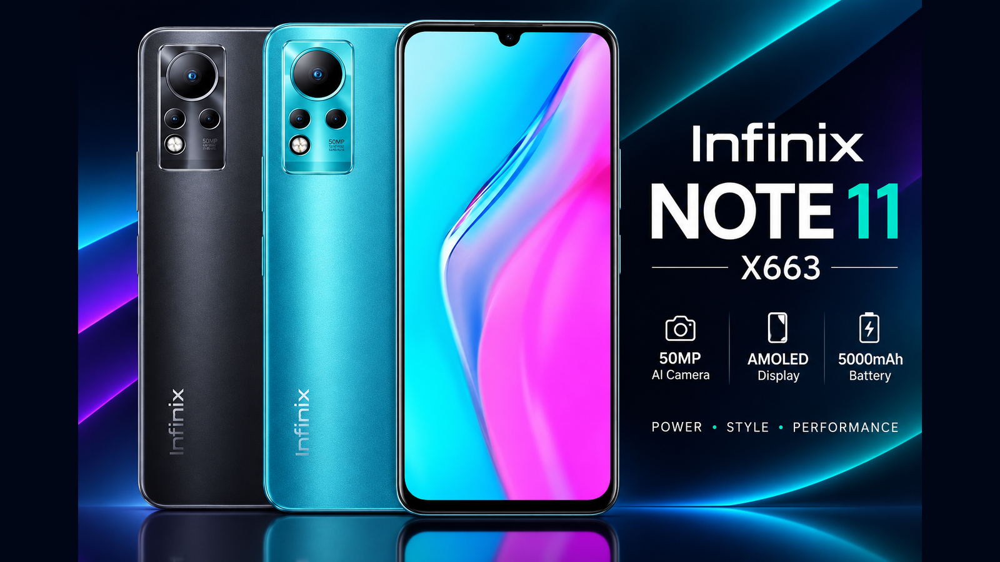

<style>
  .x663-hero {
    background: linear-gradient(135deg, #101c2c 0%, #1b2a3a 45%, #274b63 100%);
    border: 1px solid rgba(255, 255, 255, 0.08);
    border-radius: 20px;
    padding: 48px 20px;
    text-align: center;
    box-shadow: 0 20px 50px rgba(0, 0, 0, 0.35);
  }
  .x663-hero img {
    border-radius: 14px;
    box-shadow: 0 18px 40px rgba(0, 0, 0, 0.45);
    animation: x663Float 7s ease-in-out infinite;
  }
  @keyframes x663Float {
    0%, 100% { transform: translateY(0); }
    50% { transform: translateY(-10px); }
  }
</style>

<div align="center" class="x663-hero">
  
  <div style="margin-top: 18px; color: #c9d6e3; font-size: 18px;">
    <strong>MediaTek MT6768 / Helio G88 · Android 12 · Infinix X663</strong>
  </div>
</div>

<h1 align="center">📱 Infinix Note 11 (X663)</h1>
<p align="center"><strong>Device tree for the Infinix Note 11 — MediaTek MT6768 / Helio G88, Android 12.</strong></p>

---

## Device

| | |
| --- | --- |
| **Model** | Infinix Note 11 (X663) |
| **SoC** | MediaTek MT6768 / Helio G88 (2× Cortex-A75 + 6× Cortex-A55) |
| **Display** | 6.7" 1080×2460, 480 dpi, 60 Hz |
| **Stock ROM** | XOS 10.6.0, Android 12, `X663-H6915ABCEFGHIO-S-GL-230918V670` |
| **Partitions** | Virtual A/B, dynamic (`system`, `system_ext`, `product`, `vendor`) |
| **First API level** | 30 |
| **Vendor VNDK** | 31 |

## ✨ Highlights

- **Source-built vendor partition** — no prebuilt `vendor.img`; stock blobs installed from `proprietary/`.
- **Stock vendor policy** retained (v31) with platform policy v32 fallback handling.
- **Framework resource overlay** with corrected Android 12 power profile (6+2 cluster CPU layout).

## 🏗️ Vendor mode

This tree uses a **normal source-built vendor partition**.

- `device.mk` inherits `vendor/infinix/X663/X663-vendor.mk`, which installs the stock
  blobs from `vendor/infinix/X663/proprietary/`.
- The vendor repository's `Android.mk` recreates the 196 stock symlinks that
  `PRODUCT_COPY_FILES` cannot preserve.
- `configs/fs_config` supplies the stock ownership and mode metadata through `TARGET_FS_CONFIG_GEN`.

The stock vendor SELinux policy is kept as shipped:

- `vendor_sepolicy.cil`, context files and `precompiled_sepolicy` come from the blob tree.
- `selinux_policy_nonsystem` is filtered out.
- `PRODUCT_PRECOMPILED_SEPOLICY := false` prevents AOSP from replacing the stock policy.
- No reconstructed MTK `.te` sources are added.

## 📦 Source tree layout

```text
device/infinix/X663/
├── AndroidProducts.mk
├── aosp_X663.mk              # AOSP 12 product
├── lineage_X663.mk           # LineageOS 19.1 product
├── BoardConfig.mk            # kernel, partitions, AVB, vendor build, density
├── device.mk                 # dynamic partitions, fstab, recovery, APNs
├── vendor.prop               # stock vendor properties
├── configs/apns-conf.xml     # stock carrier APN database
├── configs/fs_config         # stock vendor ownership/modes
├── overlay/frameworks/base/core/res/
│   ├── res/values/config.xml       # framework config overlay
│   ├── res/values/dimens.xml       # status bar / cutout dimensions
│   └── res/xml/power_profile.xml   # corrected MT6768 power profile
├── recovery/
│   ├── Android.mk
│   └── root/
│       ├── init.recovery.mt6768.rc
│       ├── system/bin/mtk_plpath_utils
│       └── system/etc/init/mtk-plpath-utils.rc
├── rootdir/etc/fstab.mt6768
├── extract-files.sh
├── LICENSE
├── NOTICE
└── README.md
```

The kernel lives in `kernel/infinix/X663`; the vendor tree is in `vendor/infinix/X663`.

## 🔨 Build

```bash
repo init -u https://android.googlesource.com/platform/manifest -b android-12.0.0_rXX
repo sync -j8

cp -a device/infinix/X663   aosp/device/infinix/
cp -a vendor/infinix/X663   aosp/vendor/infinix/
cp -a kernel/infinix/X663   aosp/kernel/infinix/
cd aosp
. build/envsetup.sh
lunch aosp_X663-userdebug
m -j$(nproc)
```

Useful image targets:

```bash
m bootimage dtboimage systemimage system_extimage productimage vendorimage \
  vbmetaimage vbmeta_systemimage vbmeta_vendorimage superimage
```

`vendorimage` builds an ext4 vendor filesystem; it does not copy a prebuilt image.

## ⚖️ Licensing

Original device-tree files are licensed under **Apache-2.0** (see `LICENSE` and `NOTICE`).
The stock APN database, the prebuilt `mtk_plpath_utils` binary and stock-derived
recovery/fstab files are third-party material and are not relicensed. Files marked
`LicenseRef-Stock-Firmware` remain subject to Infinix/Transsion terms.

## ⚠️ Notes and limitations

- The trees have **not** been compiled or booted against a full AOSP checkout in this
  environment; wiring is validated by inspection and stock vendor metadata comparison.
- The prebuilt kernel is stock; kernel source was not published with the firmware.
- The stock vendor policy is version 31 while LineageOS 19.1 platform policy is version 32;
  runtime fallback and vendor HAL loading still need a device test.
- AVB uses AOSP test keys and disabled verification for unlocked devices; replace the test
  keys before distributing production builds.
